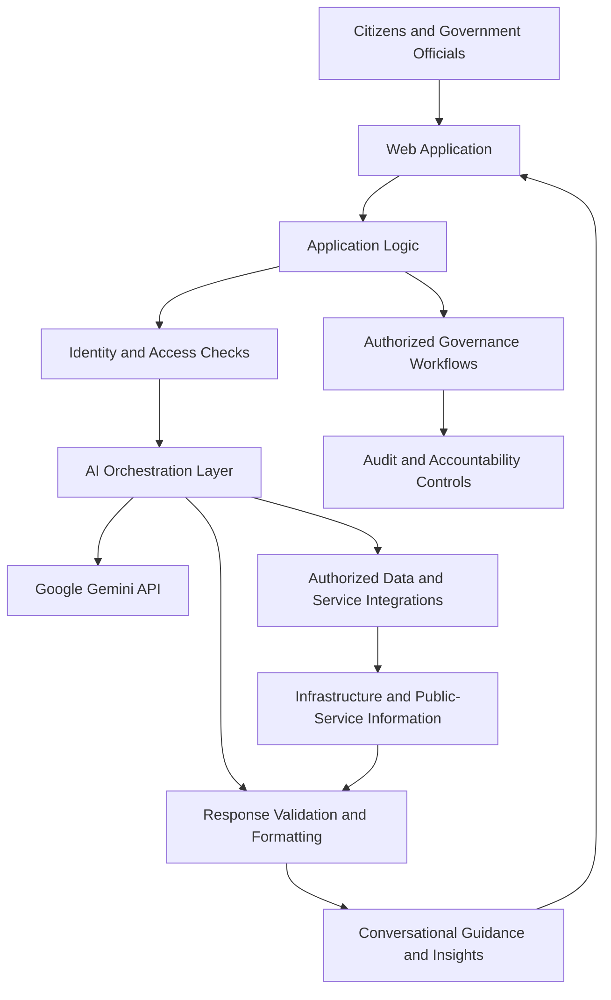
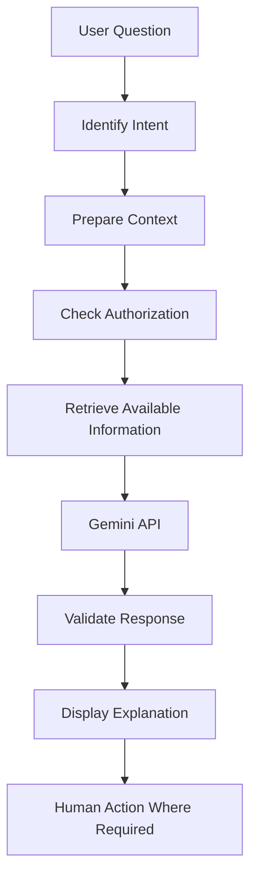

# National Infrastructure Intelligence (NII)

### An AI Orchestration Layer for Digital Public Infrastructure (DPI) and Governance

**National Infrastructure Intelligence (NII)** is an AI-powered platform concept designed to improve how citizens, government departments, and policymakers interact with public infrastructure information and digital public services.

The platform aims to transform fragmented public-service information into accessible, conversational experiences while helping authorized officials understand infrastructure needs, review information, and make informed decisions.

NII focuses on connecting citizen needs with relevant public services, administrative jurisdictions, and governance workflows through an AI-assisted interface.

**Live Demo:** [https://national-infrastructure-intelligence.vercel.app/](https://national-infrastructure-intelligence.vercel.app/)

**Hackathon Track:** Build with AI — DPI & Governance (India Focus)

**AI Integration:** Google Gemini API

**Deployment:** Vercel

---

## 📑 Table of Contents

- [Overview](#-overview)
- [Problem Statement](#-problem-statement)
- [Our Solution](#-our-solution)
- [Project Objectives](#-project-objectives)
- [Key Features](#-key-features)
- [System Architecture](#-system-architecture)
- [Technology Stack](#-technology-stack)
- [AI Orchestration Layer](#-ai-orchestration-layer)
- [Citizen Interaction Workflow](#-citizen-interaction-workflow)
- [Governance and Access Control](#-governance-and-access-control)
- [Jurisdiction-Based Intelligence](#-jurisdiction-based-intelligence)
- [Data Processing and Intelligence](#-data-processing-and-intelligence)
- [Security and Responsible AI](#-security-and-responsible-ai)
- [Getting Started](#-getting-started)
- [Environment Configuration](#-environment-configuration)
- [Deployment](#-deployment)
- [Limitations](#-limitations)
- [Future Roadmap](#-future-roadmap)
- [Author](#-author)

## 🌐 Overview

Public infrastructure and government service delivery involve multiple departments, administrative jurisdictions, information systems, and citizen interaction channels.

Citizens may struggle to understand which service is relevant to their situation, where to submit a request, which department is responsible, or how to interpret complicated public-service information.

Government officials, meanwhile, need reliable information to understand local development needs, prioritize issues, and coordinate action across administrative levels.

National Infrastructure Intelligence aims to bridge these challenges with a common AI-assisted interface.

The platform's central idea is to create a more accessible connection between:

- **Citizens:** People seeking information, assistance, and access to public services.
- **Local administration:** Officials responsible for local issues and citizen requests.
- **Departments:** Authorities managing specific public services and infrastructure.
- **State administration:** Officials coordinating programs and regional priorities.
- **National policymakers:** Decision-makers examining broader development patterns.
- **System administrators:** Personnel responsible for authorized platform configuration and oversight.

NII uses AI as an interface and coordination layer rather than treating a conversational model as a replacement for official government systems.

## 🎯 Problem Statement

### 1. Fragmented public-service information

Information about infrastructure programs and public services may be distributed across different portals, departments, and administrative systems.

This makes it difficult for citizens to find the right information and understand the appropriate next step.

### 2. Complex citizen interactions

Traditional digital interfaces may require users to understand departmental terminology, navigate multiple pages, or know the correct process before they can receive useful assistance.

A conversational interface can make this interaction more intuitive.

### 3. Disconnect between local needs and higher-level planning

A local infrastructure issue may require action from a specific department while also contributing to a broader regional or national development priority.

Connecting these different perspectives can support better coordination.

### 4. Limited contextual understanding

The same issue may require different information or actions depending on its location, responsible department, urgency, and administrative jurisdiction.

A useful governance platform must consider this context instead of returning identical information to every user.

### 5. Trust, authorization, and accountability

AI-assisted governance must distinguish publicly accessible information from restricted administrative information.

It also needs understandable outputs, appropriate access controls, and records of consequential actions.

## 💡 Our Solution

National Infrastructure Intelligence proposes an AI orchestration layer that brings together conversational access, jurisdiction-aware information, and administrative workflows.

Instead of requiring every user to navigate complex information systems independently, NII aims to help users express their needs in natural language and receive relevant guidance.

The intended workflow is:

1. **Understand:** Interpret a citizen's question or public-service need.
2. **Contextualize:** Identify the relevant service, location, and administrative context.
3. **Retrieve:** Obtain information from authorized sources available to the application.
4. **Analyze:** Organize relevant information and identify possible next steps.
5. **Explain:** Present the result in clear, accessible language.
6. **Route:** Direct the user toward the appropriate service or workflow where supported.
7. **Review:** Allow authorized personnel to review requests and information within their jurisdiction.

AI-generated guidance must remain distinguishable from confirmed government records, official decisions, and verified service outcomes.

## ✨ Key Features

### 1. Conversational Citizen Interface

The platform is designed to make public-service information easier to understand through natural-language interaction.

Instead of requiring citizens to know the name of a department or navigate complex menus, the interface can help interpret a question and identify relevant guidance.

**Example interaction:**

A citizen asks:

> Which public service department should I contact about a damaged local road?

The platform can explain the relevant category of service and, when reliable routing information is available, direct the citizen toward the appropriate authority or reporting channel.

The actual response depends on the information and integrations available to the application.

### 2. AI-Powered Information Assistance

The Gemini API provides the AI integration identified for the project.

An AI-assisted interface can help interpret questions, summarize available information, and present answers in a conversational format.

Useful applications include:

- Explaining public-service procedures.
- Summarizing infrastructure information.
- Converting complex administrative language into clearer explanations.
- Helping users understand possible next steps.
- Supporting structured information retrieval when the relevant tools are implemented.

The model should not invent official policies, claim that a service request was submitted when it was not, or treat unsupported statements as verified government information.

### 3. Infrastructure and Public-Service Intelligence

NII is intended to connect public infrastructure needs with relevant service categories and administrative contexts.

The platform's broader objective is to make it easier to understand where an issue belongs, what information is relevant, and which authority may be responsible.

Potential applications include:

- Public infrastructure issue discovery.
- Department and service identification.
- Development-need categorization.
- Access to relevant public information.
- Administrative summaries and decision support.

The availability and accuracy of these functions depend on the implemented modules and connected data sources.

### 4. Jurisdiction-Aware Governance

Administrative context is central to the NII design.

The platform distinguishes between national, state, district, and local development contexts.

This helps establish a consistent approach to organizing information and determining which users should be able to view or act on particular records.

A citizen-facing response, a district-level operational report, and a national policy summary may require different levels of detail and authorization.

### 5. Role-Based Access Control

NII's governance model identifies six user roles:

| Role                 | Intended responsibility                                                     |
| -------------------- | --------------------------------------------------------------------------- |
| Citizen              | Access permitted public-service information and citizen-facing workflows    |
| District Officer     | Review information and matters within the authorized district               |
| Department Officer   | Manage department-specific information and assigned responsibilities        |
| State Administrator  | Examine authorized state-level information and coordinate regional activity |
| National Policymaker | Review permitted national-level summaries and development priorities        |
| System Administrator | Manage authorized system settings, access, and operational configuration    |

These role descriptions define the intended governance model. The actual permissions must be enforced by the application's authentication and authorization logic.

### 6. Explainable Information and Risk Indicators

Where analytical indicators are implemented, the platform should communicate why an issue or development need has been highlighted.

A useful explanation identifies:

- The factor that triggered the indicator.
- The information supporting it.
- The source and freshness of that information.
- Any uncertainty or missing data.
- The next step that may require human verification.

An analytical score is a decision-support signal, not an official determination or proof of wrongdoing.

### 7. Governance and Accountability

The NII design includes four important governance principles:

- **Role-Based Access Control (RBAC):** Access depends on the user's authorized role.
- **Anonymized Signals:** Aggregated insights should avoid exposing unnecessary personal information.
- **Explainable Scoring:** Analytical results should be accompanied by understandable reasons.
- **Audit Trail:** Consequential actions should be traceable where audit logging is implemented.

These principles are particularly important when AI is used in public-service workflows.

## 🏗️ System Architecture

The following diagram illustrates the proposed logical architecture of NII. It is a conceptual representation, not a claim that every component operates as a separately deployed service.



### Layer 1: Presentation Layer

The presentation layer provides the user-facing interface.

Its responsibilities include:

- Rendering pages and reusable interface components.
- Accepting user input.
- Displaying responses and available information.
- Managing navigation and interaction states.
- Communicating with application services.

The exact framework and UI libraries should be documented according to the project's package configuration.

### Layer 2: Application Logic

The application layer handles request processing and coordinates the operations required to answer a user.

Responsibilities can include:

- Validating input.
- Preparing prompts or structured requests.
- Calling configured AI services.
- Retrieving data from implemented integrations.
- Handling errors and response states.
- Formatting results for presentation.

### Layer 3: AI Orchestration Layer

This is the central concept behind NII.

The orchestration layer coordinates AI interpretation with the context and information available to the application.

A well-structured implementation should separate:

- User intent interpretation.
- Context and authorization checks.
- Data retrieval.
- AI-assisted reasoning.
- Response validation.
- Final user-facing presentation.

The orchestration layer should not grant the AI model unrestricted access to sensitive data or administrative actions.

### Layer 4: Data and Service Integration

This layer connects the application to the information it is permitted to use.

Potential sources include official public-service resources, infrastructure datasets, departmental APIs, and application-managed records.

Only configured and verified integrations should be documented as working connections. A conversational interface alone does not imply that the platform has live access to government databases.

### Layer 5: Governance and Accountability

This layer defines how users are authorized, how information is scoped to their jurisdiction, and how consequential operations are reviewed.

A production implementation should enforce access restrictions at the server or data-service layer rather than relying only on frontend visibility rules.

## 🛠️ Technology Stack

The following table identifies the technologies established by the project context and the details that should be confirmed against the source repository.

| Component              | Technology                 | Purpose                                                  |
| ---------------------- | -------------------------- | -------------------------------------------------------- |
| AI integration         | Google Gemini API          | Natural-language understanding and AI-assisted responses |
| Hosting and deployment | Vercel                     | Deploying and serving the web application                |
| Frontend framework     | Verify from `package.json` | Rendering and routing                                    |
| UI library             | Verify from dependencies   | Components and interface interactions                    |
| Styling framework      | Verify from dependencies   | Layout, styling, and responsive design                   |
| Backend/API            | Verify from source files   | Request handling and service integration                 |
| Database               | Verify from configuration  | Persistent storage, if implemented                       |
| Authentication         | Verify from source files   | User identity and session management                     |
| Authorization          | Application implementation | Enforcing roles and jurisdiction boundaries              |
| Version control        | Git/GitHub, if used        | Source-code history and collaboration                    |

A careful README should not list a database or authentication provider as part of the implemented stack until the code confirms it.

### Why Gemini API?

A generative AI model can help interpret natural-language questions and formulate understandable responses.

For a governance platform, its output should be grounded in relevant information wherever possible. The application should distinguish retrieved facts from model-generated explanations and handle unavailable or contradictory information safely.

### Why Vercel?

Vercel provides hosting and deployment infrastructure for web applications. It allows the project to be accessed through a public deployment URL and can support automated deployments when a repository is connected.

A deployed website does not, by itself, confirm the presence of a production database, live public-sector integrations, or secure administrative workflows.

## 🤖 AI Orchestration Layer

The AI orchestration layer connects conversational input to application context and relevant information.

### Step 1: User intent

The application interprets the user's question to identify the type of assistance required.

Possible intent categories include:

- Finding public-service information.
- Understanding an infrastructure issue.
- Identifying a relevant department.
- Requesting a summary of available information.
- Seeking help navigating an administrative workflow.

These categories are illustrative unless explicitly configured in the implementation.

### Step 2: Context preparation

The application identifies the context required to process the request.

Depending on the workflow, context may include:

- The requested service.
- The relevant location.
- The available public information.
- The authenticated user's permitted scope.
- The task the application is able to perform.

Sensitive user or administrative information should not be sent to external AI services unless necessary and appropriately authorized.

### Step 3: Information retrieval

When a suitable data source or application tool is configured, the orchestration layer can retrieve relevant information before generating a response.

For example, a question about a government scheme should be answered from an appropriate source when one is available, rather than relying exclusively on the model's general knowledge.

### Step 4: AI-assisted reasoning

The model uses the supplied question and permitted context to formulate an appropriate answer.

The application should define clear instructions and response constraints to reduce unsupported claims and misleading recommendations.

### Step 5: Response handling

The application processes the model's response, handles failures, and displays the result.

For critical governance workflows, validation and authorization must remain outside the model's control.



This pipeline represents a recommended logical flow. Its actual sequence should be adjusted to match the implemented application.

## 🏛️ Governance and Access Control

NII is designed around the principle:

**ROLE + JURISDICTION → AUTHORIZED INFORMATION + ACTIONS**

This means that access should depend not only on who the user is, but also on which administrative scope they are authorized to access.

For example:

- A citizen should not automatically receive access to restricted administrative records.
- A district officer should be restricted to the district or responsibilities assigned to them.
- A department officer should access information required for authorized departmental duties.
- A state administrator should be permitted to review the relevant state-level information.
- A national policymaker should receive appropriately authorized national-level summaries.
- A system administrator should manage system functions without automatically receiving unrestricted access to every category of sensitive content.

### RBAC: Role-Based Access Control

RBAC maps users to roles and roles to permitted actions.

Typical permission categories include:

- View public information.
- View jurisdiction-scoped records.
- Create or update an authorized request.
- Review assigned cases.
- Access aggregate summaries.
- Manage configuration and user access.

The precise permission matrix must match the application's actual implementation.

### Jurisdiction boundaries

Jurisdiction rules define the administrative scope of information.

A secure implementation should validate the user's permitted jurisdiction on the server for each protected operation. Changing a location filter in the browser must not grant access to a different jurisdiction.

### Anonymized signals

Aggregated infrastructure trends may help policymakers identify common needs without unnecessarily revealing citizen identities.

Anonymization should be designed carefully, because small groups or combinations of attributes may still make individuals identifiable.

### Explainable scoring

Any issue prioritization or risk indicator should communicate the factors and evidence underlying the result.

Users should be able to distinguish source facts, derived measurements, model suggestions, and administrative decisions.

### Audit trail

For consequential actions, an audit record can capture:

- The action performed.
- The timestamp.
- The responsible account or authorized system process.
- The relevant record identifier.
- The outcome of the operation.

Audit logs should be protected against unauthorized modification and should avoid retaining unnecessary sensitive information.

## 🗺️ Jurisdiction-Based Intelligence

The platform's governance model follows the hierarchy:

**India → State → District → Local Development Need**

This gives the application a consistent way to organize context and authorized information.

### National level

Provides a broad perspective on permitted infrastructure and public-service information.

Potential use cases include:

- Reviewing aggregated development needs.
- Comparing high-level trends.
- Identifying regional differences.
- Supporting policy research.

### State level

Supports analysis of information relevant to an individual state.

Potential use cases include:

- Comparing district-level development priorities.
- Reviewing regional patterns.
- Coordinating information across authorized departments.

### District level

Focuses on local administrative needs and issues within the district.

Potential use cases include:

- Reviewing assigned citizen requests.
- Understanding recurring local issues.
- Identifying the relevant department or workflow.

### Local development need

Represents an individual service need, public infrastructure issue, or other localized concern.

The application should preserve appropriate links to its location, information source, status, and responsible authority where such records are supported.

This hierarchy is intended to improve contextual relevance; it does not mean every record should automatically be visible at all levels.

## 📊 Data Processing and Intelligence

Useful governance insights depend on more than AI-generated text. They also depend on structured, reliable, and appropriately scoped information.

A possible analytical workflow is:

1. Collect information from authorized sources.
2. Validate required fields and source metadata.
3. Normalize values and administrative identifiers.
4. Associate information with the relevant service and jurisdiction.
5. Calculate permitted aggregate indicators.
6. Generate an explanation or summary.
7. Present results with context, source information, and uncertainty.
8. Allow the relevant authority to verify findings before consequential action.

### Source reliability

A reliable system should distinguish:

- Official source records.
- User-provided information.
- Demonstration or synthetic data.
- Derived calculations.
- AI-generated explanations.

These categories should not be presented as equally authoritative.

### Data freshness

Where information depends on external sources, it is useful to display the source and last-updated time when that information is available.

AI responses should not imply that data is current if the underlying information may be outdated.

## 🔐 Security and Responsible AI

Governance applications require particular care because users may interpret system responses as official or authoritative.

Important safeguards include:

- Keep private API keys on the server.
- Enforce access control outside the frontend.
- Minimize the personal information included in prompts.
- Validate user input and external data.
- Avoid unsupported claims about official policies or service status.
- Provide a clear distinction between guidance and official decisions.
- Preserve relevant source information for consequential outputs.
- Use audit logging for protected actions where implemented.
- Provide graceful handling for unavailable AI services.
- Require appropriate human review for high-impact decisions.

**Human oversight is essential.** The AI assistant should support information access and decision-making without independently granting entitlements, approving official applications, or making binding administrative decisions unless a properly authorized and validated workflow explicitly supports the action.

## 🚀 Getting Started

The application is publicly accessible at:

[https://national-infrastructure-intelligence.vercel.app/](https://national-infrastructure-intelligence.vercel.app/)

To run the project locally, first inspect the repository to confirm the framework, scripts, and dependencies.

### Prerequisites

Depending on the actual stack, you may need:

- Git.
- Node.js and a package manager, if the project uses a Node-based framework.
- Access to the Google AI Studio or Gemini API configuration, if required.
- Any additional credentials required by implemented integrations.

### 1. Clone the repository

```bash
git clone <YOUR_GITHUB_REPOSITORY_URL>
cd <YOUR_PROJECT_DIRECTORY>
```

Replace these placeholders with the actual repository address and directory.

### 2. Install dependencies

For a Node.js project that uses npm:

```bash
npm install
```

Follow the lockfile and package-manager requirements of the actual repository.

### 3. Configure environment variables

Create the environment file required by the selected framework and configure the Gemini API key if the application uses it for server-side requests.

Refer to the next section and the project's existing environment-variable references.

### 4. Start development

For a project whose `package.json` defines the standard Vite development script:

```bash
npm run dev
```

Use the exact command specified in the repository's scripts if the framework differs.

## ⚙️ Environment Configuration

The exact variable names depend on the implementation.

A common server-side Gemini configuration is:

```env
GEMINI_API_KEY=your_api_key_here
```

This is an illustrative variable name; the code may use a different name.

### Security requirements

- Never commit an actual API key.
- Do not expose private API credentials through public frontend environment variables.
- Add local environment files to `.gitignore`.
- Configure production secrets through the deployment platform.
- Rotate any credential that is accidentally published.
- Avoid sending sensitive citizen records to an external model without an appropriate legal and security basis.

## ☁️ Deployment

NII has a public Vercel deployment:

**[https://national-infrastructure-intelligence.vercel.app/](https://national-infrastructure-intelligence.vercel.app/)**

A typical deployment workflow is:

1. Push the project to its source repository.
2. Connect the repository to Vercel.
3. Configure the framework and build settings.
4. Add required environment variables through the deployment dashboard.
5. Deploy the application.
6. Test the deployed interface and AI features.
7. Verify API-key handling, error states, and all relevant access controls.

The precise commands and build settings must match the repository configuration.

## 🧪 Testing and Validation

For a governance application, testing should cover more than whether the homepage loads.

### Functional testing

- Check the main navigation and interactive components.
- Test valid, empty, and invalid user inputs.
- Verify AI response loading and error handling.
- Confirm that unavailable services produce a clear message.

### AI response testing

- Test questions with insufficient information.
- Check for unsupported policy claims.
- Verify that source facts and AI interpretations are distinguishable.
- Evaluate responses to ambiguous questions.
- Confirm that external service failures do not produce misleading success messages.

### Authorization testing

- Verify each user role's permitted scope.
- Test that restricted records cannot be accessed through modified requests.
- Confirm that jurisdiction boundaries are enforced on the server.
- Check that unauthorized users cannot trigger protected actions.

### Governance testing

- Confirm that any displayed score has a documented calculation or basis.
- Check that derived insights retain appropriate source context.
- Test audit-record creation for consequential actions where implemented.
- Verify that anonymized aggregates do not expose unnecessary personal information.

Performance, accuracy, security, and coverage metrics should be published only after they have been measured.

## ⚠️ Limitations

- AI responses can be inaccurate, incomplete, or outdated.
- Access to official data depends on the availability and authorization of data sources.
- A public deployment does not necessarily provide live integration with government systems.
- Jurisdiction-aware responses require reliable location and administrative context.
- AI-generated scores should not be treated as official determinations.
- The reliability of aggregated insights depends on data quality and methodology.
- Secure role-based access requires server-side enforcement and testing.
- Production use in government workflows requires appropriate security, privacy, accessibility, and operational validation.

## 🔮 Future Roadmap

### Phase 1: Conversational service access

Improve natural-language interaction and make public-service information easier to understand.

### Phase 2: Verified information integration

Connect authorized datasets and APIs with clear source attribution and freshness indicators.

### Phase 3: Jurisdiction-aware workflows

Strengthen the relationship between user roles, administrative scope, and permitted actions.

### Phase 4: Explainable governance analytics

Introduce carefully validated indicators that help officials understand patterns in authorized infrastructure information.

### Phase 5: Accountability and monitoring

Expand auditability, access monitoring, testing, and operational reliability.

### Phase 6: Broader interoperability

Explore responsible integration with relevant Digital Public Infrastructure and public-service systems where access and technical compatibility permit.

These phases describe potential improvements, not guarantees that every capability is already implemented.

## 👨‍💻 Project Information

**Project Name:** National Infrastructure Intelligence (NII)

**Focus:** AI, Digital Public Infrastructure, and Governance

**Hackathon Track:** Build with AI — DPI & Governance (India Focus)

**AI Integration:** Google Gemini API

**Deployment Platform:** Vercel

**Live Demo:** [https://national-infrastructure-intelligence.vercel.app/](https://national-infrastructure-intelligence.vercel.app/)

**Developer:** Pushkar Dilip Pathare

## 📄 Disclaimer

National Infrastructure Intelligence is an AI-assisted governance and public-service technology project. The application should not be assumed to represent an official government platform or to have authorized access to government records unless such status and access have been independently established.

AI-generated responses and analytical insights should be verified before being relied upon for consequential administrative decisions.
